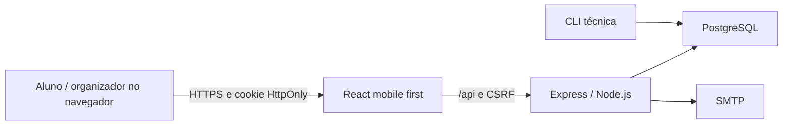
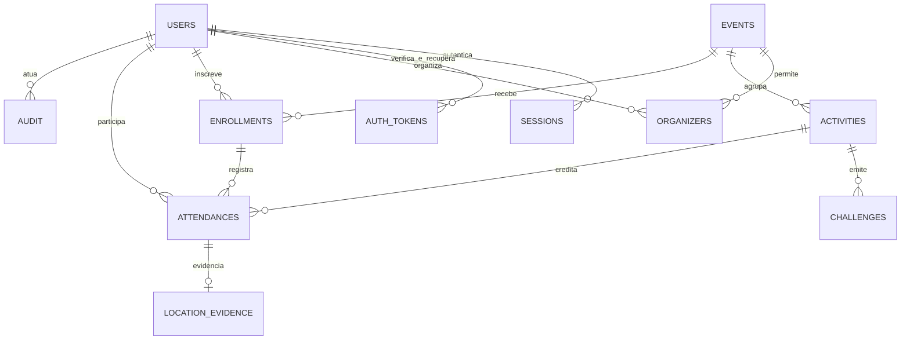
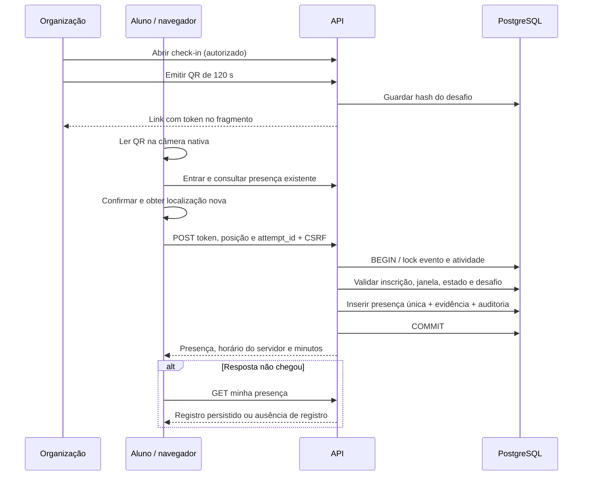

# Arquitetura e contratos



O Express serve o build React e a API no mesmo domínio. Vite é apenas ferramenta de desenvolvimento/build. Não há service worker, cache de presença, sincronização offline ou escrita direta do navegador no banco. PGlite é um fallback exclusivamente de desenvolvimento no servidor; produção requer `DATABASE_URL`.

## Modelo de dados



Unicidades SQL em usuário/evento (inscrição) e usuário/atividade (presença). `attendances.minutes` é um snapshot; não depende de mudanças futuras em `activities.minutes`. O `attempt_id` permite identificar a tentativa, mas a proteção principal é a unicidade de negócio. Localização fica separada para retenção independente. Não há endpoint comum que retorne coordenadas.

## Sequência de presença



O GET que abre o QR não grava presença. O servidor determina o aluno pela sessão e a carga horária pela atividade; ignora tentativas de escolher esses dados no corpo. Fechamento e alterações usam lock exclusivo; o check-in mantém locks de leitura até o commit. A ordem de locks é evento → atividade. Inserções concorrentes usam `ON CONFLICT` e retornam o registro único.

## API

Corpos JSON, erros `{ error, code?, details? }`. IDs UUID. Instantes ISO 8601 com offset; persistência UTC. Campos de formulário são interpretados no fuso do evento, não no fuso implícito do navegador.

| Método e rota | Acesso / efeito |
|---|---|
| GET `/api/health` | Saúde da aplicação e banco |
| GET `/api/auth/me` | Usuário atual e CSRF; sem sessão retorna usuário nulo |
| POST `/api/auth/register` | Cadastro sempre como aluno; envia confirmação |
| POST `/api/auth/login`, `/logout` | Criar/invalidar sessão |
| POST `/api/auth/verify`, `/resend` | Confirmar e reenviar e-mail |
| POST `/api/auth/forgot`, `/reset` | Recuperar acesso; reset invalida sessões |
| GET `/api/events`, `/api/events/:id` | Somente publicados |
| POST `/api/events/:id/enroll` | Conta verificada, período vigente; idempotente |
| GET `/api/me/enrollments`, `/api/me/attendances` | Exclusivamente os dados da sessão |
| GET `/api/activities/:id` | Detalhes para preparar confirmação |
| GET `/api/activities/:id/my-attendance` | Recuperar resultado sem nova escrita |
| POST `/api/activities/:id/check-in` | Validar e persistir presença |
| GET/POST `/api/organizer/events` | Eventos do organizador / criar |
| GET/PUT `/api/organizer/events/:id` | Consultar / editar evento vinculado |
| POST `/api/organizer/events/:id/status` | Publicar ou encerrar |
| POST `/api/organizer/events/:id/activities` | Criar atividade |
| GET/PUT `/api/organizer/activities/:id` | Consultar / editar regras da atividade |
| POST `/api/organizer/activities/:id/state` | Abrir/fechar entrada |
| POST `/api/organizer/activities/:id/qr` | Emitir desafio de curta validade |
| GET `/api/organizer/events/:id/enrollments` | Inscritos do evento vinculado |
| GET `/api/organizer/events/:id/report`, `/export` | Relatório JSON / CSV |

Exemplo de confirmação:

```json
{
  "token": "<token opaco de 64 caracteres do QR>",
  "attempt_id": "<UUID da tentativa>",
  "location": {
    "latitude": -25.44,
    "longitude": -49.27,
    "accuracy": 12,
    "captured_at": "2026-11-06T15:00:00.000Z"
  }
}
```

Cabeçalho `X-CSRF-Token` obtido em `/api/auth/me`. Token CSRF não é o token do QR. Latitude/longitude/precisão devem ser números finitos dentro dos limites. Sem conta, inscrição, código vigente, janela aberta e localização utilizável, não há novo registro.

Códigos úteis: `AUTH_REQUIRED`, `EMAIL_UNVERIFIED`, `CSRF`, `FORBIDDEN`, `NOT_ENROLLED`, `CHECKIN_CLOSED`, `OUTSIDE_WINDOW`, `QR_EXPIRED`, `STALE_LOCATION`. O cliente diferencia erros da Geolocation API (negada, indisponível, timeout) de erros da API.

## Segurança operacional

Senhas bcrypt, tokens e sessões armazenados por hash, queries parametrizadas, validação Zod, Helmet, limites de payload e tentativas, cookie HttpOnly e CSRF. Tokens não aparecem em query strings nem nos logs comuns do backend. CSV escapa aspas e neutraliza fórmulas, inclusive com espaços antes de `=`, `+`, `-` ou `@`.

O limite HTTP inicial é de 600/minuto por usuário autenticado ou 1000/minuto por IP anônimo. Login, cadastro e recuperação têm limite de 20/15 minutos por endereço de e-mail, rota e IP, para não agrupar todos os alunos de uma rede compartilhada; o benchmark desabilita rate limiting e mede validação/persistência. Em piloto com rede compartilhada, dimensione esses limites e a capacidade antes da abertura para não bloquear participantes atrás do mesmo NAT. Para múltiplas réplicas, substituir o armazenamento em memória do limitador por uma solução compartilhada ou controle equivalente no proxy. O MVP funciona como uma instância Node; não exige Redis.

QR compartilhável e coordenadas de cliente são barreiras, não prova absoluta. O sistema não presume que matrícula autodeclarada comprova identidade institucional.
