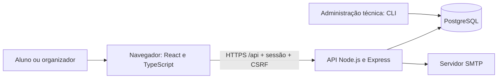
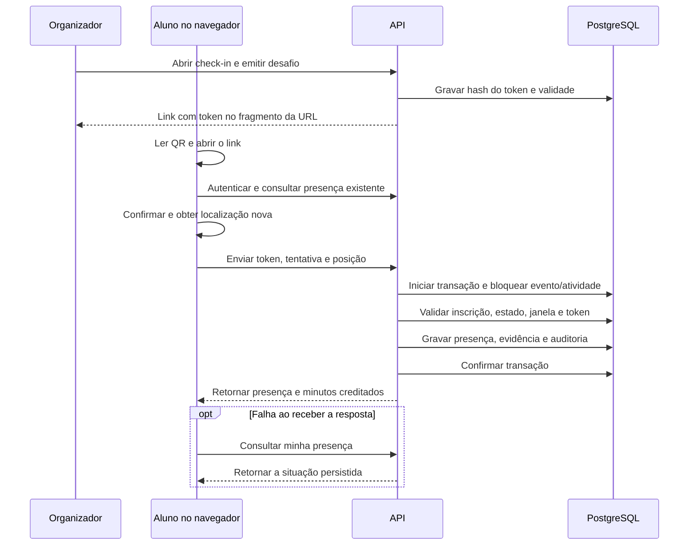

# Sistema de Credenciamento Acadêmico — Arquitetura, Requisitos e Casos de Teste

## 1. Objetivo e referência de escopo

O sistema permite que alunos se inscrevam em eventos acadêmicos e confirmem presença nas atividades por meio de QR Code e coleta pontual de localização. A organização gerencia eventos, atividades, inscrições e frequência.

Este documento consolida o plano `Plano_TCC2_Web_Mobile_First.md` e a implementação do projeto. O plano prevalece sobre o PDF do TCC1, utilizado como contexto. As propostas ainda não adotadas são identificadas explicitamente.

### 1.1 Decisões adotadas

- Aplicação web mobile first, com React e Node.js.
- Evento como agrupador de atividades; inscrição no evento dá acesso a todas as atividades.
- Aluno lê, com a câmera nativa do celular, o QR Code da atividade exibido no local.
- A leitura prepara a confirmação; somente um POST autenticado pode registrar presença.
- Uma confirmação de entrada concede integralmente os minutos previstos; não há check-out ou medição de permanência.
- Localização obrigatória, registrada sem bloqueio por distância nesta versão.
- Funcionamento online: sucesso somente após confirmação de persistência pelo servidor.
- Nome e e-mail obrigatórios; matrícula opcional; cadastro público sempre como aluno.
- Sem certificados, funcionamento offline, aplicativo Flutter ou integração institucional no MVP.

## 2. Definição da arquitetura

### 2.1 Visão geral

A solução adota uma arquitetura cliente-servidor com backend monolítico organizado por módulos. O frontend apresenta os fluxos; a API concentra autenticação, autorização e regras de negócio; o banco mantém os registros e as restrições de integridade.



### 2.2 Componentes e responsabilidades

| Componente | Tecnologia | Responsabilidade |
|---|---|---|
| Interface web | React, TypeScript e React Router | Eventos, formulários, inscrições, confirmação, histórico e painel. |
| Build e desenvolvimento | Vite | Gerar os arquivos estáticos e apoiar desenvolvimento. |
| API | Node.js, Express e TypeScript | Validar requisições, aplicar regras, controlar sessão e persistir dados. |
| Validação | Zod | Validar identificadores, campos, datas e coordenadas. |
| Banco de produção | PostgreSQL | Usuários, vínculos, eventos, atividades, inscrições, desafios QR, presenças e auditoria. |
| Banco local opcional | PGlite | Motor PostgreSQL embarcado no servidor para desenvolvimento sem instalação separada. |
| E-mail | Nodemailer e SMTP | Confirmação de endereço e recuperação de senha. |
| Geolocalização | Geolocation API | Obter uma posição nova na tentativa de check-in. |
| QR Code | Biblioteca `qrcode` | Codificar o link de confirmação da atividade. |
| Implantação reproduzível | Docker e Compose | Configurar aplicação, PostgreSQL e serviço de e-mail de desenvolvimento. |

PGlite não representa um modo offline: o navegador continua dependendo da API. Em produção, a aplicação exige PostgreSQL convencional, domínio HTTPS e SMTP configurado.

### 2.3 Organização do backend

| Módulo | Arquivo | Responsabilidade |
|---|---|---|
| Autenticação | `server/modules/auth.ts` | Cadastro, sessão, verificação de e-mail e recuperação. |
| Eventos e inscrições | `server/modules/events.ts` | Consulta pública, inscrição e consultas do aluno. |
| Check-in | `server/modules/checkin.ts` | Validar tentativa e consultar presença existente. |
| Organização | `server/modules/organizer.ts` | Eventos, atividades, publicação, entrada e emissão de QR. |
| Relatórios | `server/modules/reports.ts` | Frequência e exportação CSV protegidas. |
| Persistência | `server/db.ts` e `server/schema.sql` | Adaptadores, transações, migrations e integridade. |
| Retenção | `server/retention.ts` e `server/purge.ts` | Remover evidências vencidas conforme prazo configurado. |

### 2.4 Entidades principais

| Entidade | Dados e restrições |
|---|---|
| Usuário | Nome, e-mail único, matrícula opcional, hash da senha e estado da conta. |
| Sessão | Hash do token, usuário, proteção CSRF e expiração. |
| Token de autenticação | Hash, finalidade e expiração para verificação ou recuperação. |
| Evento | Responsável, descrição, local, fuso, período, inscrições e estado. |
| Vínculo de organização | Permissão de um usuário sobre um evento específico. |
| Atividade | Evento, título, início/fim, minutos previstos e janela/estado de check-in. |
| Inscrição | Usuário e evento; uma inscrição por par usuário/evento. |
| Desafio QR | Atividade, hash do token, validade e revogação. |
| Presença | Usuário, inscrição, atividade, horário do servidor, minutos creditados e tentativa; uma por usuário/atividade. |
| Evidência de localização | Latitude, longitude, precisão e horários, separada da presença para retenção independente. |
| Auditoria | Ator ou contexto técnico, ação, recurso e momento. |

### 2.5 Fluxo de confirmação



O desafio dura até 120 segundos, limitado ao encerramento da janela. Pode ser usado por vários inscritos e não é consumido pela primeira leitura. O QR não contém dados de alunos; o token fica no fragmento da URL e é enviado no corpo da confirmação.

A API determina usuário, atividade e minutos. A transação e a restrição única no banco impedem crédito duplicado. As horas são copiadas para a presença e não mudam silenciosamente quando a configuração da atividade é alterada.

### 2.6 Segurança, privacidade e operação

- Sessão em cookie HttpOnly, SameSite=Lax e Secure em produção; verificação de Origin e token CSRF nas mutações autenticadas.
- Senhas protegidas com bcrypt; tokens de sessão, QR e recuperação armazenados por hash.
- Autorização verificada na API por conta e vínculo com o evento.
- Consultas parametrizadas, validação de entrada e limites de requisições.
- Coordenadas restritas, ausentes do CSV comum e removíveis por retenção configurada.
- CSV com neutralização de células interpretáveis como fórmulas.
- Eventos encerrados e presenças preservados; sem exclusão comum de histórico.
- Persistência de instantes em UTC e apresentação no fuso do evento.
- API e frontend no mesmo domínio, com prefixo `/api`; HTTPS obrigatório para uso da localização em celulares fora de localhost.

A posição é obtida com `maximumAge: 0`, preferência de alta precisão e timeout de 20 segundos. O servidor rejeita coordenadas inválidas e leituras com mais de 120 segundos ou mais de 30 segundos no futuro. Não há rastreamento contínuo. QR e localização não comprovam identidade ou presença física de forma absoluta.

## 3. Requisitos

### 3.1 Perfis

| Perfil | Ações permitidas |
|---|---|
| Visitante | Visualizar eventos publicados, cadastrar conta e iniciar autenticação/recuperação. |
| Aluno | Inscrever-se, consultar dados próprios e confirmar presença. |
| Organizador | Gerenciar somente eventos vinculados, atividades, inscritos, entrada e relatórios. |
| Administração técnica | Conceder perfil de organizador, configurar implantação, retenção e recuperação. |

Um organizador também pode participar como aluno. O perfil não concede acesso automático a todos os eventos.

### 3.2 Requisitos funcionais

| ID | Requisito | Critério de aceite |
|---|---|---|
| RF01 | Cadastro e autenticação | Cadastrar, verificar e-mail, entrar, sair e recuperar acesso; cadastro público não concede organização. |
| RF02 | Gestão de eventos | Criar, editar, publicar e encerrar eventos vinculados; acesso alheio recusado. |
| RF03 | Gestão de atividades | Título, horários, janela e minutos válidos; atividade dentro do período do evento. |
| RF04 | Consulta pública | Mostrar somente eventos publicados e programação pública. |
| RF05 | Inscrição pelo aluno | Inscrição única por evento, dentro do período permitido. |
| RF06 | Consulta de inscritos | Organização consulta inscritos apenas nos eventos vinculados. |
| RF07 | Controle de entrada | Abrir e fechar check-in; recusar novas presenças após fechamento ou fora da janela. |
| RF08 | Projeção do QR | Mostrar código vigente, atividade e estado da conexão; não apresentar código vencido como válido. |
| RF09 | Captura pontual de localização | Obter posição e precisão novas ou apresentar erro recuperável. |
| RF10 | Confirmação de presença | Gravar presença somente para aluno autenticado, verificado, inscrito e com tentativa válida. |
| RF11 | Recuperação do resultado | Consultar presença após perda de resposta, sem criar duplicidade. |
| RF12 | Histórico do aluno | Mostrar somente inscrições, presenças e soma de minutos da própria conta. |
| RF13 | Painel de frequência | Distinguir inscritos, pessoas únicas, check-ins e minutos atribuídos. |
| RF14 | Exportação CSV | Exportar identificação, evento, atividade, confirmação e minutos; omitir coordenadas. |
| RF15 | Auditoria | Registrar ações relevantes com ator ou contexto técnico e momento. |
| RF16 | Proximidade opcional | Não ativado: a versão atual registra localização sem bloquear por raio. |

### 3.3 Requisitos não funcionais

| ID | Requisito | Verificação ou condição |
|---|---|---|
| RNF01 | Mobile first e acessibilidade | Formulários e ações por toque, texto legível, foco visível e mensagens sem depender apenas de cor. Verificação em aparelhos reais pendente. |
| RNF02 | Integridade e concorrência | Requisições repetidas ou simultâneas não duplicam presença nem minutos. |
| RNF03 | Segurança de acesso | Sessão, CSRF, validação e autorização por recurso verificadas no backend. |
| RNF04 | Operação online | Desconexão não gera sucesso antecipado, fila offline ou gravação local de presença. |
| RNF05 | Privacidade | Captura somente na tentativa; retenção separada; política institucional definida antes de dados reais. |
| RNF06 | Desempenho | Meta inicial de p95 até 2 segundos na API para 500 inscritos e 50 confirmações concorrentes, sem incluir login ou captura da posição. |
| RNF07 | Recuperação | Reinício e restauração preservam presenças confirmadas. |
| RNF08 | Manutenibilidade | Backend por módulos, código TypeScript, migrations e testes automatizados. |
| RNF09 | Compatibilidade | Avaliar Android/Chrome, iPhone/Safari e desktop, registrando versões efetivamente usadas. |
| RNF10 | Implantação | Produção com PostgreSQL, HTTPS, SMTP e backup; configuração local reproduzível documentada. |

A meta de desempenho é um critério de avaliação; não representa garantia universal na implantação final.

### 3.4 Regras de negócio

| ID | Regra |
|---|---|
| RN01 | Uma inscrição por aluno/evento; repetir retorna a existente. |
| RN02 | Somente conta autenticada, verificada e inscrita pode registrar nova presença. |
| RN03 | QR pertence à atividade e pode atender vários alunos inscritos. |
| RN04 | Nova confirmação exige atividade aberta, janela e token vigentes segundo o servidor. |
| RN05 | Uma presença por aluno/atividade, protegida por unicidade no banco. |
| RN06 | Uma entrada concede integralmente os minutos previstos, sem check-out. |
| RN07 | Minutos creditados ficam registrados no momento da confirmação. |
| RN08 | O cliente não escolhe livremente o aluno ou a carga horária. |
| RN09 | Toda confirmação automática exige localização utilizável. |
| RN10 | Repetições e concorrência retornam o registro existente sem somar horas. |
| RN11 | Operações comuns preservam eventos encerrados e presenças. |
| RN12 | Bloqueio de crédito entre atividades sobrepostas é proposta não ativada; depende de validação organizacional. |

## 4. Casos de teste

### 4.1 Condições gerais

Usar banco de teste isolado; contas verificadas de aluno, organizador responsável e organizador sem vínculo; evento com inscrição vigente; atividade com janela configurada. Tokens e posições podem ser simulados nos testes automatizados. Simulação não substitui câmera/GPS em campo.

As linhas abaixo descrevem 26 testes automatizados existentes. Algumas linhas agrupam várias asserções de um mesmo teste.

| ID | Referência | Procedimento e condição | Resultado esperado |
|---|---|---|---|
| CT01 | RF01, RF15 | Cadastrar aluno enviando privilégio indevido; verificar e-mail; reutilizar token; inspecionar cookie. | Perfil continua aluno; token de uso único; cookie HttpOnly/SameSite. |
| CT02 | RF01, RNF03 | Enviar mutação anônima, sem CSRF, com Origin indevido ou conta não verificada. | Requisição recusada e nenhuma operação protegida realizada. |
| CT03 | RF02–RF04 | Criar rascunho; consultar publicamente; publicar sem atividade; criar atividade válida e publicar. | Rascunho oculto; publicação incompleta recusada; programação válida publicada. |
| CT04 | RF02, RF06, RF14 | Outro organizador tenta consultar/editar evento, inscritos, relatórios ou entrada. | Acesso recusado em todos os recursos sem vínculo. |
| CT05 | RF05, RN01 | Enviar dez inscrições concorrentes do mesmo aluno; tentar inscrição fora do período e sem verificação. | Uma inscrição e mesmo identificador; tentativas indevidas recusadas. |
| CT06 | RF08, RN03 | Emitir QR com entrada fechada; abrir e emitir; consultar atividade sem confirmar. | Emissão fechada recusada; token no fragmento e hash no banco; GET não cria presença. |
| CT07 | RF09–RF10 | Enviar tentativa de não inscrito, posição ausente/inválida, precisão negativa, QR inválido ou captura antiga. | Falha específica e ausência de nova presença. |
| CT08 | RF07–RF08 | Expirar token; fechar e reabrir entrada; reutilizar desafio revogado; tentar fora da janela. | Nova confirmação recusada conforme estado, validade e janela. |
| CT09 | RF10, RN05, RN10 | Fazer 50 confirmações concorrentes do mesmo aluno; incluir usuário/minutos indevidos no corpo. | Uma presença, uma evidência, um crédito; resposta identifica o aluno da sessão e os minutos da atividade. |
| CT10 | RF11–RF12, RN07 | Consultar resultado; fechar entrada; alterar minutos futuros; repetir tentativa; consultar como outro aluno. | Mesmo registro e minutos originais; nenhuma exposição do histórico alheio. |
| CT11 | RF13–RF14 | Exportar aluno com nome iniciado por fórmula; consultar painel. | CSV neutralizado, sem coordenadas; contagens e minutos consistentes. |
| CT12 | RF01 | Recuperar senha com token expirado; usar token válido; reutilizá-lo; entrar com senha antiga e nova. | Expirado/reutilizado recusados; senha nova aceita; sessões anteriores invalidadas. |
| CT13 | RNF02, RNF06 | Preparar 500 inscritos e confirmar 50 alunos distintos em paralelo; medir latências. | Todas as confirmações válidas persistidas, sem duplicidade; p95 avaliado contra 2 segundos. |
| CT14 | RF02, RN11 | Encerrar evento e tentar abrir entrada/publicar novamente. | Evento preservado, não listado publicamente e sem reabertura comum. |
| CT15 | RNF07 | Persistir dados no PGlite, fechar/reabrir e restaurar cópia física feita com banco parado. | Registros preservados após reinício e restauração. |
| CT16 | RF01, RNF03 | Exceder tentativas para um e-mail e testar outro na mesma rede. | Primeiro endereço limitado; outro endereço não bloqueado pelo mesmo contador de login. |
| CT17 | RF15, RNF05 | Tentar retenção sem prazo válido; executar com prazo e evidências vencidas. | Prazo inválido recusado; coordenadas vencidas removidas, presenças/minutos preservados e ação auditada. |
| CT18 | RF09 | Solicitar duas capturas e inspecionar opções, precisão e horário retornados. | Duas leituras, `maximumAge: 0`, alta precisão e timeout de 20 segundos. |
| CT19 | RF09 | Simular permissão de localização negada. | Mensagem orienta habilitar permissão e tentar novamente. |
| CT20 | RF09 | Simular timeout e posição indisponível. | Mensagens específicas e recuperáveis para cada causa. |
| CT21 | RF09, RNF03 | Solicitar localização em contexto inseguro. | Captura recusada com orientação para HTTPS. |
| CT22 | RF11, RNF04 | Simular falha de transporte na chamada à API. | Cliente retorna erro de rede, sem confirmação fictícia. |
| CT23 | RF01 | Enviar e-mail por Nodemailer a servidor SMTP local de teste e verificar destinatário/link. | Mensagem contém o link correto após considerar a codificação MIME. |
| CT24 | RF01, RF04–RF05, RF12 | Em DOM simulado: explorar, abrir evento, entrar com retorno, inscrever e consultar histórico. | Navegação preserva destino e apresenta inscrição/histórico corretos. |
| CT25 | RF04, RNF01 | Em DOM simulado: buscar termo inexistente e abrir rota desconhecida. | Estados vazios e página não encontrada legíveis. |
| CT26 | RF09–RF11, RNF04 | Em DOM simulado: negar posição; depois conceder e perder resposta após persistência. | Negação não envia confirmação; não há sucesso antecipado; consulta posterior recupera presença. |

### 4.2 Casos complementares e piloto

| ID | Tipo / estado | Procedimento | Resultado esperado |
|---|---|---|---|
| CP01 | Automatizado, executado | Repetir os 17 casos de integração no PostgreSQL convencional; fazer backup físico com cluster parado, restaurar e reiniciar. | Regras aprovadas e 51 presenças do cenário preservadas após recuperação. |
| CP02 | Manual, pendente | Executar inscrição e leitura nativa do QR em Android/Chrome e iPhone/Safari reais, em HTTPS. | Link correto, autenticação, localização e presença; registrar versões usadas. |
| CP03 | Manual, pendente | No local real, negar/reabilitar permissão; observar GPS, timeout e precisão em salas. | Falhas recuperáveis e captura pontual; não inventar presença em caso de falha. |
| CP04 | Manual, pendente | Desconectar projetor e aluno; aguardar vencimento do QR; reconectar e consultar situação. | Código não tratado como vigente após falha/expiração; sem sucesso offline nem duplicidade. |
| CP05 | Manual, pendente | Avaliar celular, tablet e desktop, teclado, zoom, contraste, foco e projeção à distância. | Ações utilizáveis e feedback legível; registrar problemas observados. |
| CP06 | Operacional, pendente na implantação | Subir Docker/Compose, configurar TLS/SMTP reais e validar `pg_dump`/`pg_restore` em uma base nova. | Serviços acessíveis, e-mail recebido e restauração verificada sem sobrescrever produção. |

### 4.3 Execução e evidências

Na pasta do projeto:

```bash
npm ci
npm run build
npm test
npm run test:postgres
```

A suíte principal registrou 26 testes aprovados. Os 17 testes de integração também foram executados com PostgreSQL 18.6. Os registros de referência estão em `docs/VALIDACAO.md` e `docs/evidencias/`; os casos descritos aqui não representam uma nova execução da suíte.

O ensaio de carga de referência registrou p95 de 548 ms no PGlite e 160 ms no PostgreSQL, em ambiente local. Esses valores pertencem à execução documentada e variam conforme a máquina e a carga. Excluem login, captura de posição e tempo humano. O limitador é desabilitado somente na instância dos testes de carga e possui teste separado.

### 4.4 Critério de encerramento da validação

A entrega técnica deve compilar, aprovar os testes automatizados e preservar integridade, autorização e recuperação. A aprovação para piloto com dados reais requer adicionalmente HTTPS/SMTP configurados, política institucional de dados, ensaio de recuperação na implantação e execução dos casos de campo pendentes.

Não foram declarados resultados de câmera, GPS, usabilidade ou responsividade em dispositivos reais com base apenas nos testes automatizados de DOM.
